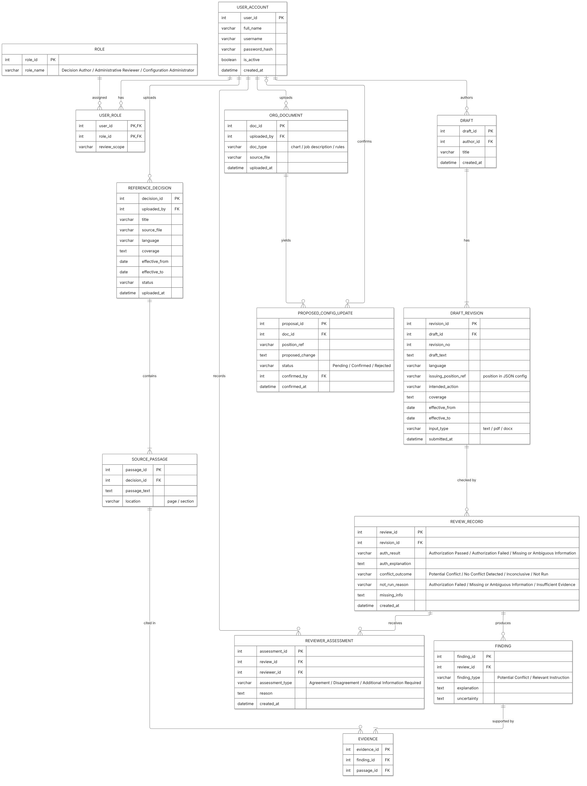
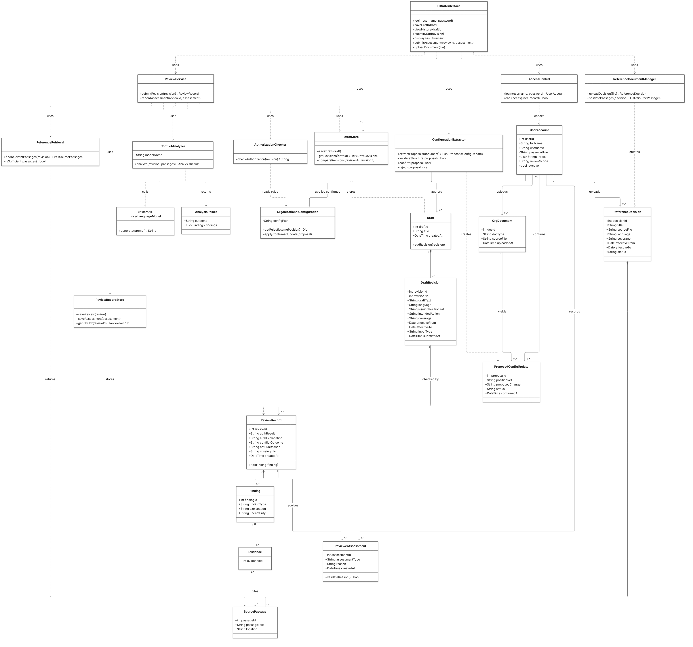

# ITISAQ — Project Report II

> Draft of Questions 1 to 5. Questions 1 and 2 were added on 2026-11-05; Questions 3 and 4 were saved on 2026-11-04. Question 5 currently contains the Entity Relationship Diagram and Class Diagram, added on 2026-11-07; the Use Case, Activity, and Sequence Diagrams are still to be added. Question 6 is not included.

## Question 1: Changes to the Project Proposal

The project's aims remain the same. ITISAQ is still a local prototype that supports human review of draft administrative decisions before issuance. In light of instructor feedback and the team's progress, the following changes were made.

| Change | Details | Reason | How it improved the proposal |
| --- | --- | --- | --- |
| Project focus | The focus widened from conflict detection to decision preparation and review. The system also helps users find applicable instructions when no conflict is found. | An instructor asked why the system would be needed if no conflicts exist. | The system now has clear value during routine work, not only when a conflict appears. |
| Working model | Gemma (`gemma4:12b`) replaced the open shortlist as the provisional model for initial development. | Gemma achieved better accuracy than Qwen in the team's preliminary tests. | Development can now focus on one model, which can still be changed after further evaluation. |
| Model fine-tuning | The team plans to fine-tune a pretrained model using project-relevant examples, subject to hardware feasibility. | The team aims to improve results on administrative tasks and develop practical fine-tuning skills. | The original and fine-tuned models can be compared on the same held-out cases to show whether fine-tuning helps. |
| Saved drafts | Users can save drafts, return to earlier reviews, and compare revisions. | This need appeared during requirements work because users revise drafts over time. | Each review stays linked to its draft revision, so later changes do not overwrite earlier results. |
| Document uploads | Users can upload documents through the interface. Drafts support text entry, PDF, and Word; existing decisions support PDF and Word; organizational documents also support PNG and JPG. | Requirements work showed that the system should match how staff handle documents. | The input requirements are now specific and testable. |
| Hardware | The initial prototype will run on one computer: Windows 11 Pro, AMD Ryzen 5 5600, 16 GB RAM, and NVIDIA GeForce RTX 4070 SUPER. | The team needed a known environment for development and testing. | Performance and fine-tuning feasibility can be measured on real hardware, without treating it as a minimum requirement. |

Fine-tuning is the largest addition because the original schedule did not include it. Its feasibility on this computer has not yet been tested.

## Question 2: Methods to Find Information

The team mainly used two approaches: a targeted literature search and local model testing. The literature search was the most effective for ITISAQ because it shaped the system design and showed what the team needed to test.

### 2.1 The Two Approaches

**Literature search:** The team used web searches and Google Scholar to find research on regulatory conflict detection, evidence-based language analysis, retrieval, and Arabic embeddings. Each selected source was then checked through its publication record and available full text. Six publications from 2021 to 2025 were retained and assessed using the PROMPT criteria.

**Local model testing:** The team ran candidate models locally through Ollama. Testing used a fixed sample of 300 Arabic and English XNLI cases, followed by 300 bilingual administrative scenarios. These tests provided direct evidence for the choice of working model.

### 2.2 Critical Comparison

| Criterion | Literature search | Local model testing |
| --- | --- | --- |
| Main strength | Provides peer-reviewed methods, known difficulties, and evaluation ideas. | Measures how models perform on the team's own tasks and computer. |
| Main weakness | Few sources address Arabic administrative text, and most papers cover other domains such as contracts or engineering requirements. | Results apply only to the tested models and cases. They do not explain how to design the complete system. |
| Reliability | Sources can be traced and evaluated, but their results may not transfer to ITISAQ. | Test conditions are controlled, but the administrative scenarios are synthetic and need human review. |
| Contribution to the project | Informs the workflow, system boundaries, and evaluation plan. | Informs the selection of a working model. |

### 2.3 Most Effective Approach

The literature search was the most effective approach for three reasons:

1. **It shaped the design.** Research on conflict analysis and formal reasoning supported separating LLM analysis from explicit permission and scope checks.
2. **It guided the evaluation.** The literature showed the need to evaluate retrieval separately, test Arabic independently, and present supporting evidence.
3. **It came first.** Without this foundation, the team would not have known which tasks the local tests needed to measure.

Local model testing remains necessary because the literature cannot show how a model performs on ITISAQ's own tasks. The two approaches therefore complement each other, but the literature search had the greater influence on the project as a whole.

## Question 3: What Skills Do We Need?

### 3.1 Main Skills Required

Developing ITISAQ requires a combination of software development, organizational modeling, document retrieval, and model evaluation skills. These skills are necessary to build a local system that supports the review of draft administrative decisions before issuance.

| Skill | Importance to the project |
| --- | --- |
| Python programming and component integration | To implement application logic and connect organizational authorization checks, document processing, retrieval, and local language-model analysis within a coherent workflow. |
| User interface development | To enable users to submit drafts, inspect findings and supporting evidence, record reviewer assessments, and revise and resubmit drafts. |
| Organizational rule and data modeling | To represent organizational units, positions, permissions, and scopes through explicit rules, and structure decision metadata, including sources, coverage, dates, and status. |
| Document processing and Retrieval-Augmented Generation (RAG) | To prepare Arabic and English decision texts, retrieve relevant passages, and preserve their source references for evidence inspection. |
| Local large language model (LLM) fine-tuning, integration, and evaluation | To adapt a pretrained model using project-relevant examples, integrate it into the local application, and evaluate its potential-conflict analysis and evidence-supported explanations. |
| Testing and evaluation | To verify individual components and their integration, assess retrieval and conflict-analysis quality, and distinguish the sources of system errors. |

The team has an existing foundation in Python programming, component integration, and user interface development. These strengths will support application development. However, organizational modeling, document retrieval, local LLM adaptation, and evaluation require further learning and practical experience.

### 3.2 Selected Skills to Develop

Three skill areas have been selected because they directly support the successful completion of ITISAQ’s core functions. The following development plans describe intended learning and implementation activities rather than completed work.

#### 3.2.1 Organizational Rule and Data Modeling

**Justification for selection**

ITISAQ must check the issuing position’s permission and organizational scope using explicit, reviewed rules. Incorrectly modeled rules could produce unreliable authorization results even when the textual analysis is accurate. The system also requires clear structures for decision sources, coverage, effective dates, and status. Developing this skill will support reliable authorization checks and preserve the separation between organizational authority and LLM-based analysis.

**Development plan**

- Study rule-based authorization and data modeling using JavaScript Object Notation (JSON).
- Create a small fictional organizational configuration containing units, positions, permissions, and defined scopes.
- Implement authorization checks in Python without assuming that a higher organizational position automatically holds every permission.
- Test permitted, prohibited, and incomplete-information cases against predefined expected results.

#### 3.2.2 Document Processing and RAG

**Justification for selection**

Conflict analysis depends on retrieving decisions and instructions that apply to the draft. If relevant evidence is not retrieved, the analysis may be incomplete regardless of the LLM’s capabilities. ITISAQ must also process Arabic and English texts while maintaining traceable links between retrieved passages and their sources. Developing this skill is therefore necessary for producing relevant and inspectable evidence.

**Development plan**

- Learn text preparation, passage splitting, embeddings, and retrieval methods.
- Prepare a small local collection of sample decisions with metadata and source references.
- Build an initial retrieval workflow that considers coverage, dates, and status alongside semantic similarity.
- Manually identify relevant passages for sample queries, compare them with retrieval results, and investigate missing or irrelevant passages.
- Test Arabic and English queries, including retrieval across languages.

#### 3.2.3 Local LLM Fine-Tuning, Integration, and Evaluation

**Justification for selection**

ITISAQ requires a local LLM to analyze potential conflicts between draft decisions and retrieved instructions. The team needs to develop the skills to fine-tune a pretrained model using project-relevant examples and determine whether this improves analysis correctness and evidence-supported explanations. Integration and evaluation skills are also necessary to distinguish errors originating from retrieval, model interpretation, or interactions between system components.

**Development plan**

- Study the fundamentals of fine-tuning pretrained LLMs and assess methods suitable for the available local hardware.
- Prepare and review project-relevant training examples containing draft decisions, supporting instructions, and expected analyses.
- Conduct local fine-tuning experiments using a compatible method, subject to hardware feasibility, and document the training data, configuration, and results.
- Compare the original and fine-tuned models using the same held-out evaluation cases to assess correctness, evidence support, uncertainty handling, and response time.
- Integrate the model with the Python application and test the complete review workflow.
- Keep training, development, and final evaluation datasets separate to assess performance on previously unseen cases.

## Question 4: Detailed Requirements Specification

The following specification describes the intended functions, quality goals, data needs, operating environment, and security constraints of ITISAQ. Requirements expressed using “shall” define intended system behavior and do not indicate that the corresponding functions have already been implemented or tested.

### 4.1 Functional Requirements

ITISAQ shall support the review of draft administrative decisions before issuance. It shall check organizational authorization, retrieve relevant instructions, analyze potential conflicts, and present evidence for human review.

In this specification, actual coverage refers to the organizational units, people, or activities to which a decision applies.

#### 4.1.1 User Roles

| Role | Responsibilities |
| --- | --- |
| Decision Author | Prepare and submit drafts, provide relevant details, inspect findings, and revise and resubmit drafts. |
| Administrative Reviewer | Examine system results and supporting evidence, record an assessment, request missing information, and determine the appropriate next action. |
| Configuration Administrator | Upload reference documents, maintain organizational configuration, and review proposed configuration updates before activation. |

One authorized user may hold multiple roles where organizational rules permit. These roles represent responsibilities and access permissions; they do not require separate employees. Configuration-administration access does not itself grant authority to approve or issue administrative decisions.

#### 4.1.2 Organizational Configuration and Access

| ID | Requirement |
| --- | --- |
| FR-01 | The system shall maintain reviewed organizational units, positions, reporting relationships, permissions, and allowed scopes in a JSON configuration. |
| FR-02 | The system shall distinguish decision-authoring, administrative-review, and configuration-administration responsibilities through a simplified access model, allowing an authorized user to hold multiple roles. |
| FR-03 | Permission and authority checks shall use explicit, reviewed organizational rules, including precedence, exceptions, and delegation where applicable. Higher rank or a reporting relationship shall not automatically grant authority. |

#### 4.1.3 Draft Submission and Authorization Checks

| ID | Requirement |
| --- | --- |
| FR-04 | The system shall accept draft administrative decisions in Arabic and English before issuance. |
| FR-05 | Draft submission shall capture decision text, issuing position, intended action, actual coverage, and relevant dates. Suggested or extracted details shall be confirmed when needed. |
| FR-06 | The system shall check whether the issuing position has permission to perform the intended action using explicit Python-based rules. |
| FR-07 | The system shall check whether the draft falls within the issuing position’s allowed scope. |
| FR-08 | The system shall explain confirmed permission or scope failures and identify missing or ambiguous information requiring clarification. |
| FR-09 | Permission and scope checks shall precede retrieval and semantic conflict analysis. Drafts that pass these checks shall proceed to those stages. |

The user submitting a draft need not hold the issuing position identified in it. Organizational authorization checks shall use the identified issuing position.

#### 4.1.4 Existing Decisions and Retrieval

| ID | Requirement |
| --- | --- |
| FR-10 | The system shall store supplied existing decisions with their sources, actual coverage, effective dates, and status. |
| FR-11 | The system shall index decision passages and retrieve relevant existing instructions through RAG, considering content, coverage, dates, and status. |
| FR-12 | Retrieval shall support Arabic and English inputs, including relevant decisions across languages. |
| FR-13 | The system shall present relevant existing instructions to support preparation and review, including cases where no potential conflict is detected. |

#### 4.1.5 Potential Conflict Analysis and Results

| ID | Requirement |
| --- | --- |
| FR-14 | A locally running LLM shall compare the draft with retrieved applicable instructions to identify potential conflicts. |
| FR-15 | Analysis shall consider meaning, actual coverage, effective dates, exceptions, and decision status. Text similarity or shared coverage alone shall not establish a conflict. |
| FR-16 | The system shall distinguish permission or scope failures from potential conflicts between decision contents. |
| FR-17 | Results shall present findings, explanations, supporting source passages and references, uncertainty, and recommended next steps based on explicit organizational rules. |
| FR-18 | The interface shall allow users to inspect results and evidence, revise a draft, and resubmit it for analysis. |

A result indicating no detected conflict shall describe the outcome of the analysis against the reviewed sources, rather than guarantee that no conflict exists.

#### 4.1.6 Organizational Document Processing

| ID | Requirement |
| --- | --- |
| FR-19 | The system shall accept text or images of organizational charts, job descriptions, and official rules for configuration preparation. |
| FR-20 | The system shall use local text extraction, Optical Character Recognition (OCR), or a local vision-capable model where appropriate to propose structured organizational information. |
| FR-21 | Extracted descriptions and proposed organizational information shall be associated with the relevant positions. |
| FR-22 | Proposed configuration updates shall undergo structural validation, retain supporting source references, and require authorized human review and confirmation before becoming active. |

Extracted job responsibilities shall not automatically establish permission to issue administrative decisions.

#### 4.1.7 Interface Uploads and Reviewer Assessments

| ID | Requirement |
| --- | --- |
| FR-23 | The system shall allow authorized users to upload existing decisions and organizational documents through the interface. |
| FR-24 | The system shall allow draft submission through direct text entry or pasting, and through document upload. |
| FR-25 | The system shall record the Administrative Reviewer’s agreement, disagreement, or request for additional information alongside the original result and evidence. Disagreement and information requests shall include a reason. |
| FR-26 | The system shall allow authorized users to save drafts, retrieve previous reviews, and compare draft revisions while preserving the results associated with each reviewed revision. |

Supported inputs shall be as follows:

| Input category | Supported inputs |
| --- | --- |
| Draft decisions | Direct text entry or pasting, PDF, and Word (.docx). |
| Existing decisions and instructions | PDF and Word (.docx). |
| Organizational charts, job descriptions, and official rules | PDF, Word (.docx), PNG, and JPG. |

Administrative Reviewer assessments shall have the following meanings:

- Agreement: The Administrative Reviewer considers the system result supported by the available evidence.
- Disagreement: The Administrative Reviewer identifies an incorrect warning or an issue missed by the system and records a reason.
- Additional information required: The assessment remains unresolved until missing information is supplied by the Decision Author or another responsible person.

Reviewer assessments shall not automatically approve, reject, issue, or apply an administrative decision; bypass organizational permission rules; activate configuration changes; or retrain the model. Formal approval and issuance shall remain with authorized people under the organization’s process.

### 4.2 Non-Functional Requirements

The following requirements describe the operating constraints, quality goals, and evaluation obligations of ITISAQ. Quantitative acceptance criteria shall be established before formal evaluation, informed by preliminary testing on the development environment.

| ID | Requirement |
| --- | --- |
| NFR-01 | The initial prototype shall operate locally on a single computer, with LLM execution through Ollama connected to the Python application. Document processing, retrieval, and AI analysis shall remain local. |
| NFR-02 | Arabic and English handling shall be evaluated using project-relevant cases, including administrative terminology, negation, exceptions, and cross-language retrieval. |
| NFR-03 | Findings shall include understandable explanations and inspectable supporting passages and source references. Uncertainty and missing information shall be clearly identified. |
| NFR-04 | Authorization checks, retrieval, conflict analysis, and organizational information extraction shall be evaluated against reviewed reference cases. Retrieval failures shall be distinguished from model interpretation errors. |
| NFR-05 | Response time and resource usage shall be measured on the development computer. Model and tool selection shall consider processor, RAM, GPU memory, and storage constraints. |
| NFR-06 | Evaluation shall compare manual and system-assisted preparation and review in terms of correctness, time, and perceived effort. Improvements shall be treated as objectives to test rather than assumed outcomes. |
| NFR-07 | The interface shall clearly present draft submission, system results, supporting evidence, and reviewer assessments. It shall distinguish authorization failures, potential conflicts, and unresolved information. A no-conflict result shall indicate that no potential conflict was detected in the reviewed sources, rather than imply automatic approval. |

The initial development and testing environment is specified in Section 4.4.2. It constitutes the testing baseline rather than an established minimum hardware requirement. Response-time targets, resource limits, and fine-tuning feasibility remain subject to testing.

### 4.3 Data Requirements

ITISAQ shall store and process the information needed for organizational authorization checks, document retrieval, conflict analysis, and human review.

| ID | Data category | Required information |
| --- | --- | --- |
| DR-01 | Organizational configuration | Reviewed organizational units, positions, reporting relationships, permissions, allowed scopes, and applicable authority rules, represented in JSON. |
| DR-02 | Reference decisions and instructions | Document content, source references, actual coverage, effective dates, and status. Retrieved passages shall remain traceable to their source documents. |
| DR-03 | Draft decisions | Draft text, Decision Author identity, issuing position, intended action, actual coverage, relevant dates, and identifiable revisions. |
| DR-04 | Review records | The reviewed draft revision, authorization results, potential-conflict findings, explanations, supporting passages and references, uncertainty, and missing information. |
| DR-05 | Human assessments | Administrative Reviewer identity, agreement or disagreement with results, reasons, and requests for additional information. Assessments shall remain associated with the relevant review. |
| DR-06 | Users and access | User identities, assigned system roles, and applicable access scopes. One authorized user may hold multiple roles. |
| DR-07 | Proposed organizational updates | Extracted information, supporting sources, associated positions, and review/confirmation status. Unconfirmed proposals shall remain separate from active configuration. |
| DR-08 | Fine-tuning and evaluation datasets | Project-relevant examples and reviewed expected analyses. Training, development, and final evaluation datasets shall be kept separate. |

**Draft storage and review history**

Users shall be able to save drafts, return to previous reviews, and compare revisions. Each review shall remain linked to the draft revision it analyzed. Later revisions shall not overwrite the historical content, findings, evidence, or assessments needed to understand previous reviews.

**Access to saved records**

- Decision Authors shall access their own drafts and review history.
- Administrative Reviewers shall access records within their authorized review scope.
- Configuration-administration privileges alone shall not grant access to all drafts or review records.

**Data handling**

Arabic and English content shall be preserved for processing and evidence presentation. Organizational configuration updates shall undergo validation and authorized human confirmation before activation. Missing or ambiguous information shall remain identifiable rather than being replaced with invented values.

Final record schemas, storage technology, retention and deletion rules, and detailed review-scope definitions remain to be specified.

### 4.4 Software and Hardware Requirements

#### 4.4.1 Software Requirements

| Component | Requirement or current selection |
| --- | --- |
| Operating environment | Windows 11 Pro, 64-bit, on the initial development and testing computer. |
| Application logic | Python shall implement organizational checks, document processing, and integration between system components. |
| Local model execution | Ollama shall run the local LLM and connect it to the Python application. |
| Local language model | Gemma (`gemma4:12b`) is the current working choice for initial development. Its suitability and fine-tuning feasibility remain subject to testing. |
| Organizational configuration | JSON shall represent reviewed organizational information and authorization rules. |
| User interface | The interface shall support draft submission, document uploads, results, evidence inspection, reviewer assessments, and saved drafts and review history. |
| Document processing | Local tools shall process Word documents and text-based PDFs. Local OCR or a vision-capable model shall support scanned PDFs and images in the later development stage. |
| Retrieval | A local embedding model and retrieval component shall support Arabic and English passages while preserving references to source documents. |
| Persistent storage | Local storage shall retain documents, draft revisions, review results, reviewer assessments, and user-related records. |
| Model fine-tuning | A local training toolchain shall support fine-tuning the pretrained model using project-relevant examples, subject to compatibility and hardware feasibility testing. Fine-tuning tools shall be separate from Ollama’s model-execution role. |

#### 4.4.2 Hardware Requirements

The initial prototype shall run locally on the following development and testing computer:

| Component | Available specification |
| --- | --- |
| Operating system | Windows 11 Pro, 64-bit |
| Processor | AMD Ryzen 5 5600 |
| Installed RAM | 16 GB |
| Graphics card | NVIDIA GeForce RTX 4070 SUPER |
| Storage | Sufficient local storage for application dependencies, model files, uploaded documents, retrieval indexes, saved records, and training data. Required capacity shall be determined through testing. |
| Deployment | One computer running all prototype components locally. |

This configuration is the available development and testing environment, not a verified minimum specification.

Inference, document processing, retrieval, and fine-tuning shall be assessed separately because their resource requirements differ. Minimum hardware requirements and any necessary adjustments shall be determined through testing of the selected models, tools, and datasets.

### 4.5 Security Requirements

ITISAQ shall protect organizational information and restrict system operations according to authenticated user identities, assigned roles, and authorized scopes. System access permissions shall remain distinct from organizational authority to issue administrative decisions.

| ID | Requirement |
| --- | --- |
| SEC-01 | Each user shall authenticate through an individual account before accessing protected system functions and records. |
| SEC-02 | The system shall enforce access permissions for Decision Authors, Administrative Reviewers, and Configuration Administrators. An authorized user may hold multiple roles. |
| SEC-03 | Decision Authors shall access their own drafts and review history. Administrative Reviewers shall access records within their authorized review scope. Configuration-administration privileges alone shall not grant access to all drafts or review records. |
| SEC-04 | Organizational documents, drafts, retrieval data, and AI processing shall remain within the local environment. Project information shall not be transmitted to external services without explicit authorization. |
| SEC-05 | Organizational configuration changes shall require validation and confirmation by an authorized person before activation. Extracted document content shall not automatically modify active permissions or authority rules. |
| SEC-06 | Reviewer assessments shall be associated with the authenticated Administrative Reviewer and the relevant review record. Recording an assessment shall not bypass organizational authorization checks or alter the original system findings. |

### 4.6 Additional Requirements and Constraints

| ID | Requirement or constraint |
| --- | --- |
| AR-01 | ITISAQ shall support human review before decision issuance. It shall not autonomously approve, issue, or apply administrative decisions. |
| AR-02 | Organizational authorization checks shall remain separate from LLM-based conflict analysis. The model shall not invent authority or assume that higher organizational rank automatically grants permission. |
| AR-03 | System results shall be limited to the available organizational configuration and reference sources. Missing evidence and uncertain interpretations shall be identified explicitly. |

## Question 5: System Design

> The Use Case, Activity, and Sequence Diagrams are prepared separately and will be added to this section. Editable Mermaid sources for the diagrams below are stored next to the images in `figures/`.

### Entity Relationship Diagram

The ERD shows the main records ITISAQ stores to support draft submission, authorization checks, conflict analysis, and human review. All records are stored locally.

- **USER_ACCOUNT:** Stores individual user accounts used to sign in and to link each action to an identifiable user.
- **ROLE:** Holds the three system roles: Decision Author, Administrative Reviewer, and Configuration Administrator.
- **USER_ROLE:** Links users to roles, allowing one user to hold several roles. It also stores the review scope that limits which records a reviewer can access.
- **DRAFT:** Represents a draft decision owned by its Decision Author. It has one or more revisions.
- **DRAFT_REVISION:** Stores one version of a draft, including its text, issuing position, intended action, coverage, and effective dates. The issuing position refers to the JSON configuration rather than a database table.
- **REVIEW_RECORD:** Stores the system's result for a specific revision: the authorization result, analysis outcome, the reason analysis was not run if it was skipped, and missing information. A revision can be reviewed more than once.
- **FINDING:** Stores one result within a review, either a potential conflict or a relevant instruction, with its explanation and uncertainty.
- **EVIDENCE:** Links each finding to at least one source passage, so every result can be traced to the original text.
- **REFERENCE_DECISION:** Stores uploaded decisions and instructions with their source file, coverage, effective dates, and status.
- **SOURCE_PASSAGE:** Stores a passage taken from a reference decision, with its location in the original document.
- **REVIEWER_ASSESSMENT:** Stores the Administrative Reviewer's Agreement, Disagreement, or Additional Information Required. A reason is required for the last two.
- **ORG_DOCUMENT:** Stores uploaded organizational charts, job descriptions, and rules.
- **PROPOSED_CONFIG_UPDATE:** Stores configuration changes extracted from organizational documents. They stay separate from the active configuration until an authorized user confirms or rejects them.

Training, development, and evaluation datasets are not part of the application database. They are kept as separate local files so that each set stays isolated.

### Class Diagram

The Class Diagram shows the proposed software classes of ITISAQ. Service classes carry out the system's operations, and entity classes represent the stored records from the ERD.

- **ITISAQInterface:** The screens used by all three roles. It handles sign-in, saving drafts, viewing history, submitting drafts, viewing results, recording assessments, and uploading documents.
- **AccessControl:** Handles sign-in and checks whether a user may access a record based on their roles and review scope.
- **DraftStore:** Saves drafts, retrieves earlier revisions, and compares revisions.
- **ReviewService:** Main control class for the review workflow. It calls the authorization check, retrieval, and analysis in order, then saves the result.
- **AuthorizationChecker:** Checks the issuing position's permission and scope. It returns Authorization Passed, Authorization Failed, or Missing or Ambiguous Information.
- **OrganizationalConfiguration:** Reads the reviewed permission and scope rules from the JSON configuration. It applies updates only after an authorized person confirms them.
- **ReferenceRetrieval:** Finds relevant source passages and decides whether they are sufficient for analysis.
- **ConflictAnalyzer:** Compares the draft with the retrieved passages using the local language model and returns an AnalysisResult.
- **AnalysisResult:** Carries the analysis outcome (Potential Conflict, No Conflict Detected, or Inconclusive) and its findings back to ReviewService.
- **LocalLanguageModel:** External component representing the language model running locally through Ollama. It is called only by ConflictAnalyzer.
- **ReviewRecordStore:** Saves and retrieves review records and reviewer assessments.
- **ReferenceDocumentManager:** Stores uploaded reference decisions and divides them into source passages.
- **ConfigurationExtractor:** Extracts proposed updates from organizational documents, validates their structure, and records confirmation or rejection.
- **UserAccount:** Represents a system user with assigned roles and review scope. It is linked to drafts, uploads, assessments, and confirmations.
- **Draft:** Represents a draft decision owned by its author. It contains one or more revisions.
- **DraftRevision:** Represents one version of a draft. Each revision can be reviewed more than once.
- **ReviewRecord:** Represents the system's result for a revision, including the authorization result and analysis outcome.
- **Finding:** Represents one potential conflict or relevant instruction within a review.
- **Evidence:** Links a finding to its supporting source passage.
- **SourcePassage:** Represents a passage from a reference decision, with its location.
- **ReferenceDecision:** Represents an uploaded decision with its coverage, dates, and status.
- **ReviewerAssessment:** Represents the reviewer's assessment of a result, with a reason when required.
- **OrgDocument:** Represents an uploaded organizational chart, job description, or rules document.
- **ProposedConfigUpdate:** Represents an extracted configuration change awaiting confirmation or rejection.
